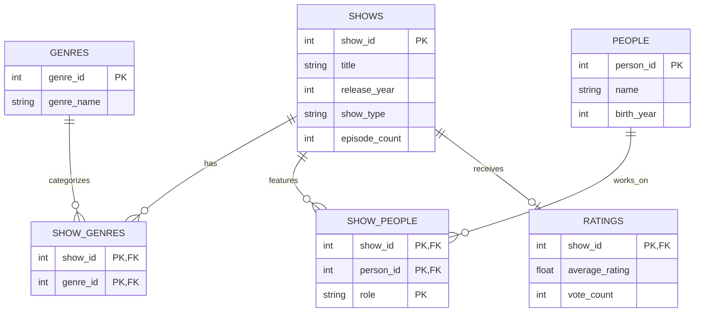

# TV Show Catalog

This database keeps track of TV shows, the people who work on them, their genres, and ratings.

## Assumptions

- Each show has its own ID, even if two shows have the same name.
- A person can work on multiple shows.
- People can be actors, writers, or both.
- A show can have more than one genre.
- Some shows might not have ratings yet.
- We might not know everyone's birth year.
- Some shows might not have an episode count available.
- Ratings show the overall score and number of votes, not every individual review.
