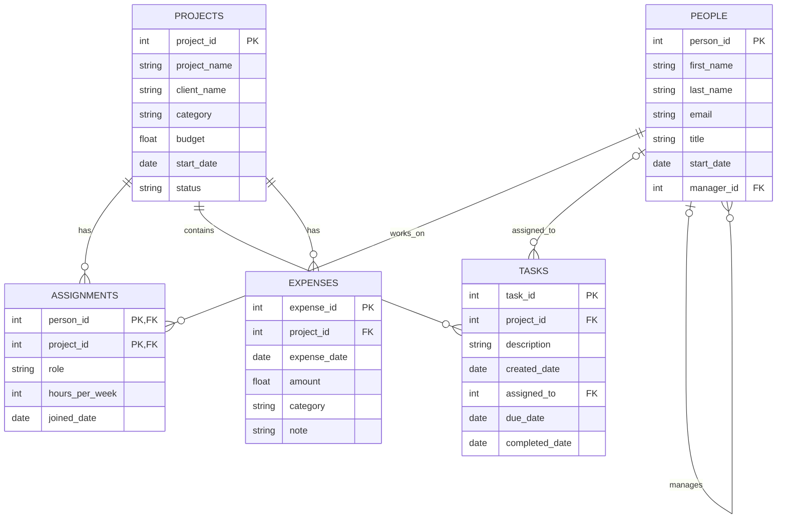

# BabsonAI Labs Database

## 1. The Scenario

I chose Scenario A, BabsonAI Labs. The company builds AI tools for small businesses and needs a database to keep track of employees, projects, assignments, tasks, and expenses.

The goal is to organize the data so the company can see who is working on each project, how many hours people are committing, and how much money each project is spending.

## 2. The ERD

## 3. What One Row Means

- PEOPLE: One row is one employee at BabsonAI Labs.
- PROJECTS: One row is one project the company is working on.
- ASSIGNMENTS: One row shows one employee working on one project, including their role and hours.
- TASKS: One row is one task that belongs to a project.
- EXPENSES: One row is one expense charged to a project.

## 4. Design Choices

**1. Why I chose these keys**

I used IDs for employees and projects instead of names or emails because those can change. For example, an employee could get a new email address, but their person ID would stay the same. For assignments, I used the employee ID and project ID together because each combination represents one person working on one project.

**2. Which relationships are optional**

Not every task needs to have someone assigned to it yet, so `assigned_to` can be empty. The founders also don't have managers, so their `manager_id` is empty. Some projects are internal and don't have a client.

**3. Which rules the database cannot check by itself**

The database cannot use a simple `CHECK` constraint to make sure the person assigned to a task is actually working on that project. I would need a query that compares tasks with assignments to find any mistakes.

**4. One design choice I changed**

I decided to keep assignments in their own table instead of putting employee IDs directly in the projects table. This makes more sense because one employee can work on several projects, and each project can have several employees.