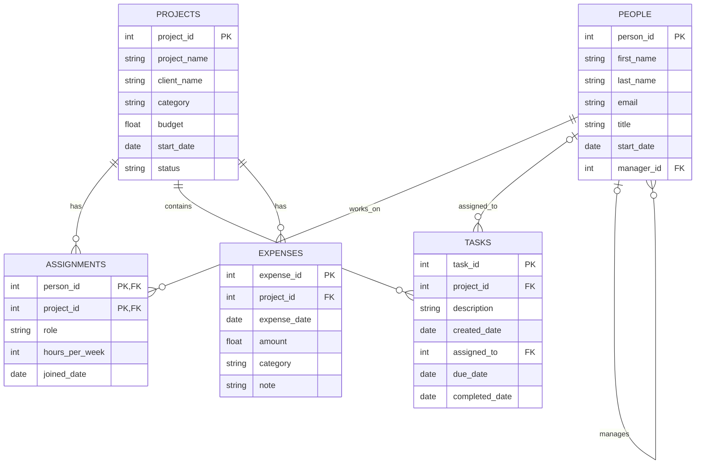

# BabsonAI Labs Database

## 1. The Scenario

I chose Scenario A, BabsonAI Labs. The company builds AI tools for small businesses and needs a database to keep track of employees, projects, assignments, tasks, and expenses.

The goal is to organize the data so the company can see who is working on each project, how many hours people are committing, and how much money each project is spending.

## 2. The ERD

## 3. What One Row Means

- PEOPLE: One row is one employee at BabsonAI Labs.
- PROJECTS: One row is one project the company is working on.
- ASSIGNMENTS: One row shows one employee working on one project, including their role and hours.
- TASKS: One row is one task that belongs to a project.
- EXPENSES: One row is one expense charged to a project.

## 4. Design Choices
